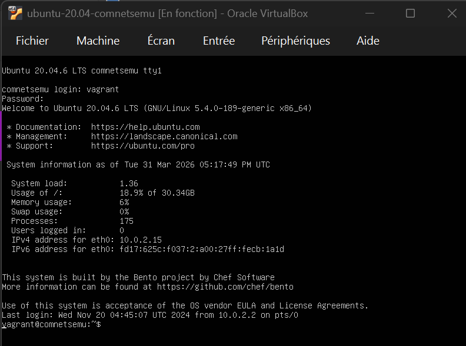

# SDN/NFV — Switch L3/L4 avec Ryu et Mininet

Commutateur SDN programmé avec le contrôleur Ryu (OpenFlow), testé sous Mininet.

## Contexte
TP1 SDN & NFV, Master 2 SRT (ESP/UCAD). Encadrant : Mr Sadio.

## Contenu
- `src/` : applications Ryu et topologie `topo.py`
- `docs/` : rapport

## Exécution
```bash
ryu-manager src/switch_L3_app.py
sudo python3 src/topo.py
```

## Licence
MIT (code) — voir `LICENSE`.

## Captures
Voir le dossier `captures/`.


